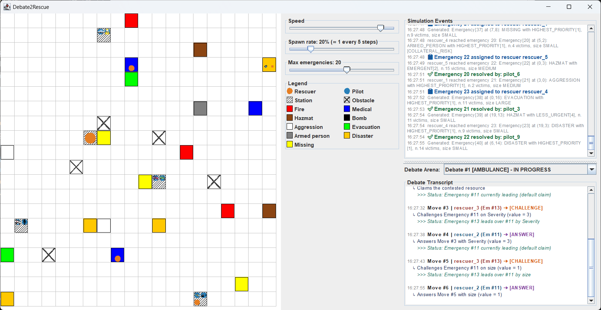

# Debate2Rescue

Multi-agent emergency response simulation where BDI agents coordinate rescue operations and resolve resource conflicts through formal argumentation (Arg2P). Developed for the *Intelligent Systems Engineering* course at the University of Bologna.

Built with **Java 21**, **Jason 3.2.1** (AgentSpeak), and **2P-Kt / Arg2P-JVM 0.16.6**.

---

## Run and Test

### Prerequisites
- **JDK 21** or higher.

### Run the Simulation
```bash
# Linux / macOS
./gradlew run

# Windows
gradlew.bat run
```
*(Or `gradle run` if Gradle is installed globally).*  
On launch, a setup dialog prompts for grid size, stations, obstacles, and agent counts (defaults are pre-filled).

### Run Tests
```bash
# Linux / macOS
./gradlew test

# Windows
gradlew.bat test
```
*(Or `gradle test` if Gradle is installed globally).*

---

## How It Works

The simulation models emergency management on an interactive 2D grid:

1. **Dispatch & Assessment**: When an emergency appears, the `orchestrator` dispatches the nearest idle `rescuer`. Upon arrival, the rescuer assesses the incident and requests the appropriate specialized resource.
2. **Argumentation Debates**: If multiple emergencies request the same resource and none is free, the orchestrator triggers a turn-based debate. Competing rescuers use structured formal argumentation (**Arg2P**, grounded semantics) to defend their claim based on priority rules. Rescuers concede when their position can no longer improve.
3. **Intervention**: The resource is granted to the winning emergency. A `pilot` delivers the vehicle to the scene, resolves the incident, and returns to the station.

---

## Application Screenshot


